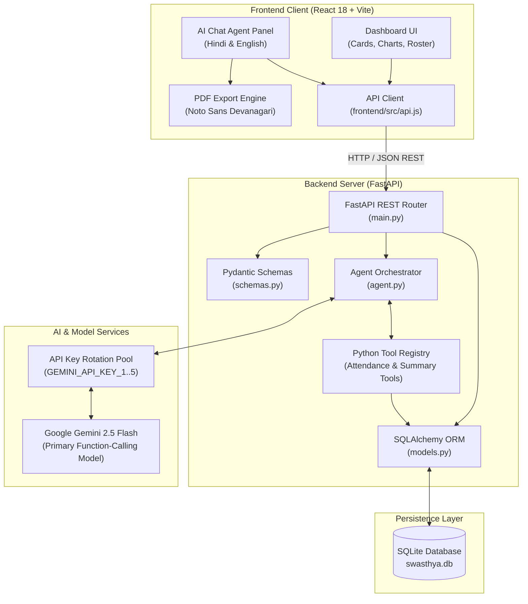

<div align="center">

# 🩺 Swasthya Sathi AI
### AI Workforce Intelligence & Attendance Monitoring for Rural Healthcare Teams

[](https://github.com/SunnyAgrwl05/Swasthya-Sathi-AI/actions/workflows/ci.yml)
[](https://fastapi.tiangolo.com)
[](https://react.dev)
[](https://vitejs.dev)
[](https://www.python.org)
[](https://nodejs.org)
[](LICENSE)
[](CODE_OF_CONDUCT.md)

<p align="center">
  <b>Bridging the gap in frontline public healthcare tracking across Bihar's Primary Healthcare Centre (PHC) Network through autonomous tool-calling AI and real-time operational analytics.</b>
</p>

[Live Web Dashboard](https://swasthya-sathi-ai-one.vercel.app) • [Backend API](https://swasthya-sathi-ai.onrender.com) • [Interactive API Docs](https://swasthya-sathi-ai.onrender.com/docs) • [Architecture Guide](docs/architecture.md) • [API Reference](docs/api.md) • [Setup Guide](docs/setup.md)

</div>

---

## 📌 Problem Statement

In rural healthcare systems across India, supervisors at **Primary Health Centres (PHCs)** manage field attendance for dozens of **ASHA (Accredited Social Health Activist)**, **ANM (Auxiliary Nurse Midwife)**, and **Anganwadi workers**. Today, these teams rely heavily on fragmented tools:

* 📝 **Paper Registers**: Manual sign-in sheets that take days or weeks to aggregate at the district level.
* 💬 **WhatsApp & SMS Groups**: Scattered messages that lack structured queryability or automatic trend detection.
* 📉 **Delayed Interventions**: Supervisors struggle to detect falling attendance patterns before field healthcare delivery (vaccinations, maternal checks) is disrupted.
* 🌐 **Language Barriers**: Administrative software is often rigid and English-only, whereas field supervisors frequently operate in **Hindi** or **Hinglish**.

**Swasthya Sathi AI** transforms these disconnected workflows into an integrated, conversational dashboard where supervisors can query attendance records, inspect anomalies, mark entries, and generate executive summaries simply by speaking or typing naturally in **Hindi or English**.

---

## 📸 Preview & Demo

### Web Dashboard


### Conversational Operations Agent (Function Calling)


> 💡 **90-Second Demo Walkthrough**: Check out the comprehensive demo script in [DEMO_SCRIPT.md](DEMO_SCRIPT.md) to see exact prompts and expected AI responses.

---

## ✨ Key Features

| Feature | Description |
|---|---|
| 🤖 **Autonomous AI Agent** | Powered by `gemini-2.5-flash` with native Python tool calling. Not a basic chatbot—it executes verified database functions to mark attendance and fetch analytics. |
| 🗣️ **Bilingual Speech & Chat** | Seamless natural-language comprehension in **Hindi, English, and Hinglish** with Web Speech API voice input support. |
| 📊 **Real-Time Analytics** | Visual attendance breakdown color-coded by performance thresholds ($\ge 80\%$ Active, $60-79\%$ Moderate, $<60\%$ Attention Needed). |
| 🚨 **Low-Attendance Detection** | Automatic proactive flagging of field workers falling below the 75% monthly threshold. |
| 📢 **Daily Broadcast Generator** | Instant synthesis of morning briefing bulletins for supervisor follow-ups via WhatsApp or SMS. |
| 📈 **Weekly Operational Insights** | AI-generated executive analysis comparing week-over-week performance with tactical recommendations. |
| 📄 **Unicode-Safe PDF Export** | Client-side report generation with embedded **Noto Sans Devanagari** TrueType fonts, ensuring crisp Hindi rendering without corrupted characters. |
| 🛡️ **Audit Logging & Telemetry** | Full trace tracking of all manual and AI-performed mutations in SQLite tables (`audit_logs`, `chat_logs`, `agent_logs`). |

---

## 🏛️ System Architecture

Swasthya Sathi AI employs a decoupled client-server architecture with an intelligent operations orchestration layer:



For complete technical specifications, see [docs/architecture.md](docs/architecture.md).

---

## 🗂️ Project Folder Structure

```text
Swasthya-Sathi-AI/
├── .github/
│   └── workflows/
│       └── ci.yml               # Automated CI/CD pipeline (Pytest, Vitest, Ruff, ESLint, Startup checks)
├── assets/
│   ├── bihar-health.png         # Bihar Health Department official emblem
│   ├── dashboard.png            # Main dashboard screenshot
│   ├── demo.svg                 # Animated SVG walkthrough of agent conversation
│   ├── thumbnail.png            # Project banner preview
│   └── thumbnail.svg            # Vector poster graphic
├── backend/
│   ├── .env.example             # Backend environment template
│   ├── agent.py                 # Gemini tool-calling agent runtime & function implementations
│   ├── database.py              # SQLAlchemy database session & engine setup
│   ├── Dockerfile               # Backend container definition
│   ├── main.py                  # FastAPI server entry point, routes, and middleware
│   ├── models.py                # SQLAlchemy database models (HealthWorker, AttendanceRecord, Logs)
│   ├── requirements.txt         # Production backend dependencies
│   ├── ruff.toml                # Ruff linter and code formatting configuration
│   ├── schemas.py               # Pydantic request and response validation schemas
│   ├── seed.py                  # Demo seed script for PHC workers & attendance data
│   ├── swasthya.db              # SQLite database file
│   └── tests/                   # Backend Pytest test suite
│       ├── conftest.py          # Pytest path and environment fixtures
│       ├── test_root.py         # API root and health check tests
│       └── test_workers.py      # Health worker endpoint tests
├── docs/
│   ├── api.md                   # Complete REST API reference with request/response schemas
│   ├── architecture.md          # Architectural deep dive with Mermaid sequence diagrams
│   ├── methodology.md           # Healthcare operations research and methodology background
│   ├── roadmap.md               # Product roadmap and upcoming milestone tracker
│   └── setup.md                 # Step-by-step local development setup guide
├── frontend/
│   ├── .env.example             # Frontend environment template
│   ├── Dockerfile               # Frontend static container definition
│   ├── eslint.config.js         # ESLint Flat Config (React, Hooks, Vitest globals)
│   ├── index.html               # Vite HTML entry point
│   ├── package.json             # Frontend dependencies & npm scripts
│   ├── tailwind.config.js       # Tailwind theme colors, fonts, and glassmorphism tokens
│   ├── vite.config.js           # Vite bundler config with backend proxy
│   └── src/
│       ├── api.js               # Centralized fetch client for backend communication
│       ├── App.jsx              # Main dashboard view layout
│       ├── App.test.jsx         # Root component unit tests
│       ├── index.css            # Global CSS styles & Tailwind directives
│       ├── main.jsx             # React DOM mounting
│       ├── setupTests.js        # Vitest environment setup
│       ├── assets/
│       │   └── fonts/           # TrueType Unicode fonts (Noto Sans Devanagari)
│       ├── components/
│       │   ├── AttendanceChart.jsx  # Recharts daily & monthly attendance progress
│       │   ├── ChatAgent.jsx        # Conversational supervisor chat with voice & PDF triggers
│       │   ├── DailyBroadcast.jsx   # Morning broadcast generation widget
│       │   ├── Header.jsx           # Top branding bar with Bihar Health logo
│       │   ├── StatCards.jsx        # KPI tiles (total workers, present today, low attendance)
│       │   ├── WeeklyInsights.jsx   # AI-generated weekly trends and strategic recommendations
│       │   └── WorkerTable.jsx      # Filterable & searchable health worker roster table
│       └── utils/
│           ├── pdfExport.js         # Unicode-safe PDF report generator (Noto Sans Devanagari)
│           └── pdfExport.test.js    # Vitest suite for Unicode PDF rendering
├── .env.example                 # Global repository environment template
├── .gitignore                   # Git ignore patterns (node_modules, venv, secrets)
├── CODE_OF_CONDUCT.md           # Contributor Covenant Code of Conduct v2.1
├── CONTRIBUTING.md               # Contributor onboarding & development guidelines
├── DEMO_SCRIPT.md               # 90-second video demo walkthrough script
├── docker-compose.yml           # Multi-container orchestration (FastAPI + Vite)
├── LICENSE                      # MIT Open Source License
└── README.md                    # Project documentation homepage
```

---

## ⚡ Quickstart & Local Installation

### Prerequisites
* **Python**: `3.11` or `3.12` installed
* **Node.js**: `18+` or `20 LTS` installed
* **Git**: `2.30+` installed
* **Google Gemini API Key**: Free key from [Google AI Studio](https://aistudio.google.com/apikey)

---

### Step 1: Clone Repository
```bash
git clone https://github.com/SunnyAgrwl05/Swasthya-Sathi-AI.git
cd Swasthya-Sathi-AI
```

---

### Step 2: Backend Setup

#### On macOS & Linux (Bash)
```bash
cd backend
python3 -m venv .venv
source .venv/bin/activate
pip install --upgrade pip
pip install -r requirements.txt
cp .env.example .env
python seed.py
uvicorn main:app --reload --host 127.0.0.1 --port 8000
```

#### On Windows (PowerShell)
```powershell
cd backend
python -m venv .venv
Set-ExecutionPolicy -Scope Process -ExecutionPolicy Bypass
.\.venv\Scripts\Activate.ps1
python -m pip install --upgrade pip
pip install -r requirements.txt
Copy-Item .env.example .env
python seed.py
uvicorn main:app --reload --host 127.0.0.1 --port 8000
```

> 🔑 **Configure API Key**: Open `backend/.env` and paste your Gemini key:
> ```env
> GEMINI_API_KEY=AIzaSy...your_gemini_key...
> GEMINI_MODEL=gemini-2.5-flash
> ```

* **Backend URL**: `http://localhost:8000`
* **Swagger UI Docs**: `http://localhost:8000/docs`

---

### Step 3: Frontend Setup

Open a second terminal window in the repository root:

```bash
cd frontend
npm install
npm run dev
```

* **Frontend Dashboard**: `http://localhost:5173`

---

### Option B: Run with Docker Compose
If you prefer containerized deployment:

```bash
# Build and run both backend and frontend
docker compose up --build
```

Access the dashboard at `http://localhost:5173` and the backend at `http://localhost:8000`.

---

## ⚙️ Environment Variables

Copy `.env.example` to configure local variables:

| Variable | Location | Required | Default | Purpose |
|---|---|:---:|---|---|
| `GEMINI_API_KEY` | `backend/.env` | **Yes** *(for AI)* | `None` | Primary Google Generative AI API key for function-calling agent |
| `GEMINI_API_KEY_2`..`5` | `backend/.env` | No | `None` | Optional fallback keys for automatic key rotation on quota limits |
| `GEMINI_MODEL` | `backend/.env` | No | `gemini-2.5-flash` | Gemini model name (`gemini-2.5-flash`, `gemini-1.5-pro`) |
| `OPENROUTER_API_KEY` | `backend/.env` | No | `None` | Optional fallback provider key for secondary report flows |
| `PORT` | `backend/.env` | No | `8000` | Port for FastAPI server |
| `VITE_API_URL` | `frontend/.env` | No | *(empty)* | Base API URL. In dev, Vite proxies `/api` to `localhost:8000` automatically. |

---

## 📡 API Overview

Swasthya Sathi AI provides standard REST APIs with auto-generated OpenAPI documentation:

| Method | Endpoint | Description | Request Example |
|---|---|---|---|
| `GET` | `/` | Health check & DB status | *None* |
| `GET` | `/api/workers` | List all registered health workers | *None* |
| `POST` | `/api/workers` | Register a new health worker | `{"name": "Anita Kumari", "worker_code": "ASHA-009", "role": "ASHA"}` |
| `DELETE` | `/api/workers/{id}` | Delete worker and records | *None* |
| `GET` | `/api/attendance` | Get attendance records (filterable by `?worker_id=1`) | *None* |
| `POST` | `/api/attendance` | Mark / update attendance entry | `{"worker_id": 1, "date": "2026-11-14", "status": "present"}` |
| `GET` | `/api/analytics/summary` | Get aggregated attendance metrics | Optional: `?days=30` |
| `POST` | `/api/chat` | Send supervisor prompt to AI agent | `{"message": "Sunita Devi ka attendance summary batao"}` |
| `GET` | `/api/broadcast/daily` | Generate daily briefing broadcast | *None* |
| `GET` | `/api/insights/weekly` | Generate weekly trends (Hindi) | *None* |
| `POST` | `/api/insights/weekly` | Generate insights with custom language | `{"language": "hi"}` |

> 📖 **Full API Specifications**: For complete request/response schemas, status codes, and curl examples, see [docs/api.md](docs/api.md).

---

## 🧪 Testing & Code Quality

Both backend and frontend maintain test suites and automated linters:

### Run Backend Tests (Pytest) & Lint (Ruff)
```bash
cd backend
pytest -v          # Execute unit tests
ruff check .       # Run Ruff linter
```

### Run Frontend Tests (Vitest) & Lint (ESLint)
```bash
cd frontend
npm test           # Execute Vitest suite
npm run lint       # Run ESLint validation
npm run build      # Verify production Vite build
```

---

## 🔧 Troubleshooting Guide

<details>
<summary><b>1. Port 8000 already in use</b></summary>

* **Symptom**: `ERROR: [Errno 10048] error while attempting to bind on address ('127.0.0.1', 8000)`
* **Solution**: Another uvicorn or backend process is still running.
  * **Windows PowerShell**:
    ```powershell
    Get-Process -Id (Get-NetTCPConnection -LocalPort 8000).OwningProcess | Stop-Process -Force
    ```
  * **Linux / macOS**:
    ```bash
    lsof -ti :8000 | xargs kill -9
    ```
</details>

<details>
<summary><b>2. All Gemini API Keys failed</b></summary>

* **Symptom**: `Exception: All Gemini API Keys failed: ...`
* **Solution**: Ensure you have added a valid API key from [Google AI Studio](https://aistudio.google.com/apikey) into `backend/.env`. Check for accidental whitespace or quotes around the key string.
</details>

<details>
<summary><b>3. Database is empty / Worker table has no data</b></summary>

* **Symptom**: Dashboard shows 0 workers and 0 attendance records.
* **Solution**: Run the seed script inside `backend/` to populate sample data:
  ```bash
  cd backend
  python seed.py
  ```
</details>

<details>
<summary><b>4. PowerShell blocks virtual environment activation</b></summary>

* **Symptom**: `Activate.ps1 cannot be loaded because running scripts is disabled on this system.`
* **Solution**: Run PowerShell and bypass execution policy for the current session:
  ```powershell
  Set-ExecutionPolicy -Scope Process -ExecutionPolicy Bypass
  .\.venv\Scripts\Activate.ps1
  ```
</details>

<details>
<summary><b>5. Frontend cannot reach backend / CORS error</b></summary>

* **Symptom**: Dashboard shows `Backend se connect nahi ho pa raha`.
* **Solution**: Verify `uvicorn` is running on `http://127.0.0.1:8000`. In development, ensure `VITE_API_URL` in `frontend/.env` is either empty or set to `http://localhost:8000`.
</details>

---

## 🤝 Contributing

We welcome contributions! Please review our contributor documentation before submitting issues or pull requests:

* 📘 [Contributing Guide (CONTRIBUTING.md)](CONTRIBUTING.md) — Workflow, code standards, and PR process.
* 📜 [Code of Conduct (CODE_OF_CONDUCT.md)](CODE_OF_CONDUCT.md) — Community pledge and guidelines.
* 🛠️ [Local Setup Guide (docs/setup.md)](docs/setup.md) — Step-by-step developer setup.
* 🗺️ [Project Roadmap (docs/roadmap.md)](docs/roadmap.md) — Future milestones and features.

---

## 📄 License

This project is open-source software licensed under the **[MIT License](LICENSE)**.

---

## 👨‍💻 Maintainer & Acknowledgments

**Sunny Kumar**
* **GitHub**: [@SunnyAgrwl05](https://github.com/SunnyAgrwl05)
* **LinkedIn**: [Sunny Kumar](https://www.linkedin.com/in/sunny-kumar-a06484297)

*Developed for the Google AI Agent Builder Series 2026, dedicated to empowering public health workers across India.*
