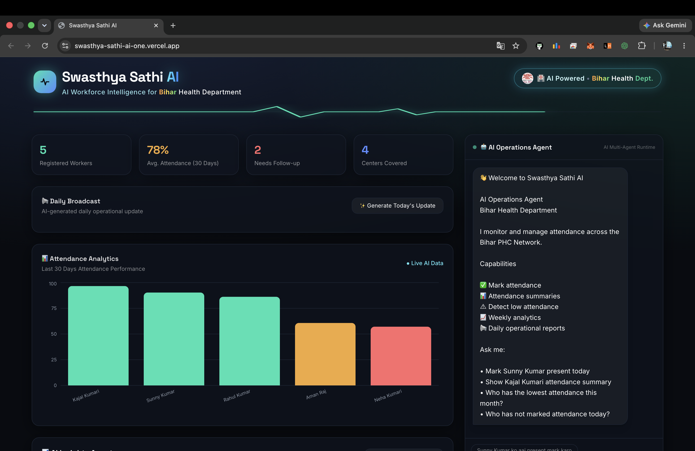

# Swasthya Sathi AI (स्वास्थ्य साथी AI)

[](https://github.com/SunnyAgrwl05/Swasthya-Sathi-AI/actions/workflows/ci.yml)
[](LICENSE)
[](https://fastapi.tiangolo.com)
[](https://vitejs.dev)
[](backend/tests/)

Swasthya Sathi AI is an AI-powered attendance and workforce monitoring system for rural healthcare teams. It combines a FastAPI backend, a React dashboard, and an AI operations agent that can understand supervisor requests, manage attendance records, summarize trends, and generate operational updates.

The project is designed around a practical public-health workflow: supervisors can track ASHA, ANM, and Anganwadi worker attendance, identify low-attendance patterns, and ask natural-language questions in Hindi or English without navigating every dashboard action manually.

## Live Demo

| Service | Link |
| --- | --- |
| Frontend | https://swasthya-sathi-ai-one.vercel.app |
| Backend API | https://swasthya-sathi-ai.onrender.com |
| API Docs | https://swasthya-sathi-ai.onrender.com/docs |

## Preview



## Problem Statement

Rural health centres often rely on paper registers, spreadsheets, and messaging groups to manage field-worker attendance. These workflows make it difficult to:

- View attendance status in real time.
- Detect workers who have not marked attendance.
- Compare recent attendance performance across workers.
- Generate supervisor-ready summaries quickly.
- Follow up on low-attendance cases before they affect service delivery.

Swasthya Sathi AI turns these fragmented workflows into a connected dashboard and AI-assisted reporting system.

## Key Features

- Natural-language AI operations agent for attendance workflows.
- Hindi and English interaction support.
- Health worker registration and listing.
- Attendance creation and update APIs.
- Attendance analytics with percentage summaries.
- Low-attendance worker detection.
- Daily broadcast generation for supervisor follow-up.
- Weekly insight reports.
- React dashboard with cards, charts, worker table, and chat panel.
- SQLite persistence through SQLAlchemy.
- FastAPI REST API with autogenerated OpenAPI docs.
- Backend and frontend tests.
- Docker and Render/Vercel deployment support.

## System Architecture

```text
Supervisor / User
       |
       v
React + Vite Frontend
       |
       | REST requests
       v
FastAPI Backend
       |
       +--> Attendance and worker APIs
       +--> Analytics endpoints
       +--> AI chat endpoint
       |
       v
AI Operations Agent
       |
       +--> Attendance tools
       +--> Summary tools
       +--> Broadcast and insight tools
       |
       v
SQLite Database
```

For a deeper architecture walkthrough, see [docs/architecture.md](docs/architecture.md).

## AI Workflow

The AI agent is not limited to plain text generation. It receives structured attendance-related capabilities and can call the appropriate workflow when a supervisor asks for an action or report.

Example prompt:

```text
Sunny Kumar ko present mark karo aur uska monthly summary dikhao
```

The backend can resolve the worker, update attendance, and return a formatted operational response. The same agent layer can also generate daily broadcasts, identify missing attendance, and summarize low-attendance workers.

For methodology details, see [docs/methodology.md](docs/methodology.md).

## Tech Stack

| Layer | Technology |
| --- | --- |
| Frontend | React, Vite |
| Styling | Tailwind CSS |
| Charts | Recharts |
| Backend | FastAPI |
| Database | SQLite |
| ORM | SQLAlchemy |
| Validation | Pydantic |
| AI | Google Generative AI, OpenRouter fallback |
| Testing | Pytest, Vitest, Testing Library |
| Deployment | Render, Vercel |
| Containerization | Docker, Docker Compose |

## Repository Structure

```text
Swasthya-Sathi-AI/
|-- backend/
|   |-- main.py
|   |-- agent.py
|   |-- models.py
|   |-- schemas.py
|   |-- tests/
|-- frontend/
|   |-- src/
|   |-- package.json
|-- docs/
|   |-- architecture.md
|   |-- methodology.md
|   |-- roadmap.md
|   |-- setup.md
|-- assets/
|-- docker-compose.yml
|-- README.md
|-- CONTRIBUTING.md
```

## API Overview

| Method | Endpoint | Description |
| --- | --- | --- |
| GET | `/` | Backend health check |
| GET | `/api/workers` | List registered health workers |
| POST | `/api/workers` | Create a health worker |
| DELETE | `/api/workers/{worker_id}` | Delete a health worker |
| GET | `/api/attendance` | List attendance records |
| POST | `/api/attendance` | Create or update attendance |
| GET | `/api/analytics/summary` | Get attendance analytics |
| POST | `/api/chat` | Send a message to the AI operations agent |
| GET | `/api/broadcast/daily` | Generate a daily broadcast |
| GET | `/api/insights/weekly` | Generate weekly insights |
| POST | `/api/insights/weekly` | Generate weekly insights with language selection |

## Local Setup

Detailed setup instructions are available in [docs/setup.md](docs/setup.md).

### Backend

```bash
cd backend
python -m venv .venv
source .venv/bin/activate
pip install -r requirements.txt
python seed.py
uvicorn main:app --reload
```

On Windows PowerShell:

```powershell
cd backend
python -m venv .venv
.\.venv\Scripts\Activate.ps1
pip install -r requirements.txt
python seed.py
uvicorn main:app --reload
```

### Frontend

```bash
cd frontend
npm install
npm run dev
```

Open the frontend at:

```text
http://localhost:5173
```

If the API runs on a separate host, set `VITE_API_URL` for the frontend.

## Environment Variables

The backend can run for basic API and test workflows without an AI key, but AI chat and generated reports require at least one model provider key.

| Variable | Purpose |
| --- | --- |
| `GEMINI_API_KEY` | Primary Google Generative AI key |
| `GEMINI_API_KEY_2` to `GEMINI_API_KEY_5` | Optional fallback Gemini keys |
| `GEMINI_MODEL` | Optional model override, defaults to `gemini-2.5-flash` |
| `OPENROUTER_API_KEY` | Optional fallback provider for some report flows |
| `VITE_API_URL` | Frontend API base URL |

## Testing

The test suites validate backend business logic, database operations, FastAPI endpoints, frontend React components, API communication services, and PDF Unicode export pipelines.

### Backend Tests (Pytest)

```bash
cd backend
pytest -v
```

### Frontend Tests (Vitest & React Testing Library)

The frontend test suite is powered by **Vitest** and **@testing-library/react** with **v8 coverage** and isolated API mocks:

```bash
cd frontend

# Run complete test suite once
npm test

# Run tests in interactive watch mode
npm run test:watch

# Generate code coverage report (text, JSON, HTML)
npm run test:coverage

# Run ESLint linter
npm run lint

# Verify production Vite build
npm run build
```

## Project Structure

```text
Swasthya-Sathi-AI/
├── assets/                  # Application banners, UI screenshots, and diagrams
├── backend/                 # FastAPI REST application
│   ├── tests/               # Pytest automated test suite
│   ├── agent.py             # Operations AI Agent and tool calling logic
│   ├── database.py          # SQLAlchemy SQLite connection and session management
│   ├── main.py              # FastAPI endpoint declarations and route handlers
│   ├── models.py            # SQLAlchemy database tables and relationships
│   ├── schemas.py           # Pydantic request and response schemas
│   ├── seed.py              # Sample health worker seeding script
│   └── requirements.txt     # Python backend dependencies
├── docs/                    # Technical architecture, API, and setup documentation
│   ├── api.md               # Detailed REST API specification
│   ├── architecture.md      # Deep dive into system architecture and data flows
│   ├── methodology.md       # Operational workflow and design rationale
│   └── setup.md             # Step-by-step local development setup guide
├── frontend/                # React 18 + Vite frontend application
│   ├── src/                 # React UI components, API clients, and utilities
│   ├── package.json         # Frontend dependencies and npm scripts
│   └── vite.config.js       # Vite build configuration
├── evaluation/              # AI quality evaluation datasets and metrics framework
├── .env.example             # Environment configuration template
├── CONTRIBUTING.md          # Contributor onboarding and pull request guidelines
├── CODE_OF_CONDUCT.md       # Community standards and code of conduct
├── docker-compose.yml       # Multi-container orchestration specification
└── LICENSE                  # MIT Open Source License
```

## Documentation

- [System Architecture](docs/architecture.md) — Detailed flow diagrams and component interaction.
- [REST API Reference](docs/api.md) — Comprehensive endpoint specifications and sample payloads.
- [Local Setup Guide](docs/setup.md) — Prerequisites and environment setup.
- [Methodology](docs/methodology.md) — Design principles and operational workflow.
- [Roadmap](docs/roadmap.md) — Planned enhancements and milestone tracking.
- [Contributing Guide](CONTRIBUTING.md) — Issue assignment and PR contribution flow.
- [Code of Conduct](CODE_OF_CONDUCT.md) — Community standards and pledge.

## Troubleshooting

### 1. `uvicorn: command not found`
Ensure your virtual environment is activated before starting the server:
```bash
# Windows
.\.venv\Scripts\Activate.ps1
# Linux / macOS
source .venv/bin/activate
```

### 2. CORS Errors (`Cross-Origin Request Blocked`)
Check that `frontend/.env` has `VITE_API_URL=http://localhost:8000` set correctly and restart Vite (`npm run dev`).

### 3. Database Locked or Permission Errors
If you encounter `sqlite3.OperationalError: database is locked`, verify that no dangling uvicorn instances are running in the background.

### 4. Running Without Gemini API Key
The application can run and pass all tests without an external API key. Mock fallback modes are built-in for offline local development and testing.

## Contributing

Contributions are welcome. Please read [CONTRIBUTING.md](CONTRIBUTING.md) and [CODE_OF_CONDUCT.md](CODE_OF_CONDUCT.md) before opening an issue or pull request.

## License

This project is licensed under the MIT License. See [LICENSE](LICENSE) for details.

## Author

Sunny Kumar

- GitHub: https://github.com/SunnyAgrwl05
- LinkedIn: https://www.linkedin.com/in/sunny-kumar-a06484297
