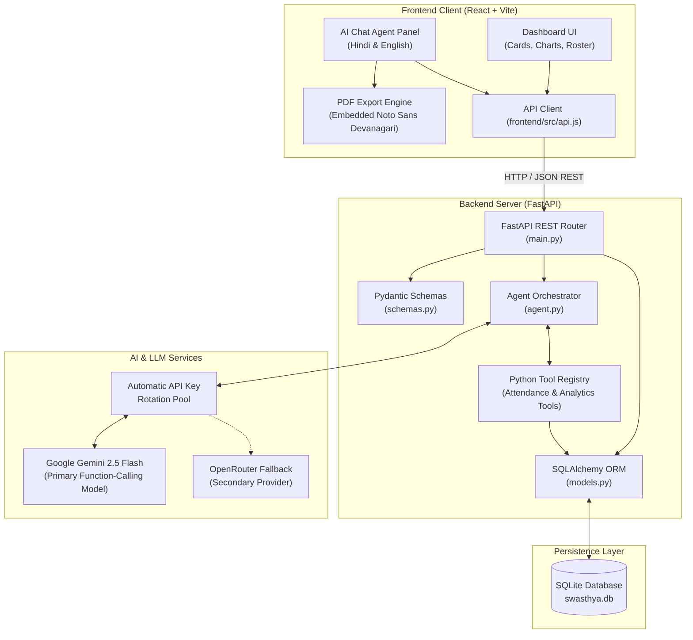
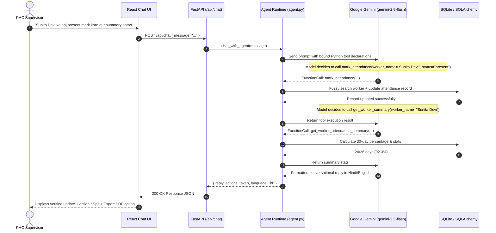

# System Architecture

**Swasthya Sathi AI** is built on a modern, decoupled client-server architecture designed for rural health operations in India. It pairs an interactive React dashboard with an autonomous, tool-calling AI agent powered by FastAPI and Google Gemini.

---

## 1. High-Level Architecture Diagram

---

## 2. Supervisor Chat & Tool-Calling Sequence

Unlike basic wrapper chatbots, Swasthya Sathi AI uses **autonomous tool execution (function calling)**. The LLM decides which functions to trigger, receives their structured results from the database, and composes an operational response.

---

## 3. Frontend Architecture

* **Framework**: React 18 with Vite for near-instant hot module replacement and efficient tree-shaking.
* **Styling**: Tailwind CSS with custom glassmorphism panels, high-contrast accessible palettes, and responsive grids.
* **Data Visualization**: Recharts for dynamic bar and progress charts color-coded by attendance thresholds (Green $\ge 80\%$, Amber $60-79\%$, Red $<60\%$).
* **Speech Recognition**: Web Speech API (`SpeechRecognition` / `webkitSpeechRecognition`) tuned to Hindi (`hi-IN`) and English for hands-free supervisor operation.
* **Unicode PDF Generation**: Dedicated client-side export engine in `frontend/src/utils/pdfExport.js` that registers base64-encoded **Noto Sans Devanagari** TrueType fonts into jsPDF Virtual File System (`addFileToVFS`), ensuring UTF-8 `/Identity-H` encoding and preventing character corruption.

---

## 4. Backend Architecture

* **Framework**: FastAPI (Python 3.11+) offering asynchronous request handling, OpenAPI auto-generation, and dependency injection (`Depends(get_db)`).
* **Data Validation**: Pydantic v2 schemas providing strict compile-time and runtime validation.
* **ORM & Database**: SQLAlchemy 2.0 with SQLite (`swasthya.db`) for rapid local setup with zero external database dependencies.
* **Key Rotation & Resilience**: Built-in rotation across multiple Gemini API keys (`GEMINI_API_KEY` through `GEMINI_API_KEY_5`) to withstand rate limits and quotas during high-volume field operations.

---

## 5. Data Model Schema

| Table | Model Class | Key Fields | Description |
|---|---|---|---|
| `health_workers` | `HealthWorker` | `id`, `name`, `worker_code`, `role`, `phone`, `center`, `is_active` | Health worker profile data (ASHA, ANM, Anganwadi, MO) |
| `attendance_records` | `AttendanceRecord` | `id`, `worker_id`, `date`, `status`, `notes`, `created_at` | Daily attendance entries (`present`, `absent`, `half-day`, `leave`) |
| `health_centers` | `HealthCenter` | `id`, `name`, `district`, `block`, `center_type` | Primary Healthcare Centres and Sub-Centres across Bihar |
| `chat_logs` | `ChatLog` | `id`, `user_query`, `agent_reply`, `actions_taken`, `language` | Complete conversational audit trail |
| `notification_logs` | `NotificationLog` | `id`, `recipient`, `message`, `channel`, `sent_at` | Broadcasts, follow-ups, and alerts dispatch records |
| `audit_logs` | `AuditLog` | `id`, `entity`, `performed_by`, `description`, `timestamp` | Audit records for compliance and traceability |
| `agent_logs` | `AgentLog` | `id`, `user_query`, `tool_name`, `tool_input`, `tool_output` | Low-level telemetry of AI tool executions |

---

## 6. Security and Data Ethics

1. **Synthetic Sample Data**: The repository ships with synthetic demo records (`backend/seed.py`) reflecting realistic public health rosters without containing real individuals' private health records.
2. **Key Isolation**: API credentials are read exclusively from environment variables and excluded from version control via `.gitignore`.
3. **Auditability**: Every manual and AI-triggered attendance modification is logged in the `audit_logs` table for administrative transparency.
