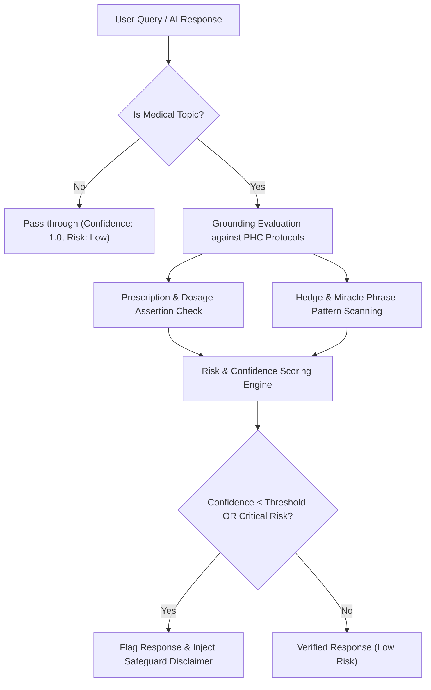

# 🛡️ Medical Hallucination Detection & Prompt Safeguards

## Overview

In clinical and public health applications like **Swasthya Sathi AI**, ensuring the safety and accuracy of AI-generated responses is paramount. Large Language Models (LLMs) can occasionally generate unsupported medical claims, fabricate dosages, or provide ungrounded clinical recommendations (hallucinations).

The **Medical Hallucination Detector** (`backend/hallucination_detector.py`) is a prompt safeguard and verification engine built specifically for Bihar's Primary Health Centre (PHC) network.

---

## Architecture & Detection Pipeline



---

## Key Capabilities

1. **Entity Grounding Verification**
   - Validates mentions against Bihar NHM / WHO Primary Health Centre protocols:
     - Maternal Health: ANC, PNC, IFA, Janani Suraksha Yojana, institutional delivery.
     - Universal Immunization Programme: BCG, OPV, Pentavalent, Rotavirus, MR.
     - Primary Care: ORS, Zinc, Dehydration, Kala-Azar, Anemia Mukt Bharat.

2. **Dangerous Prescription & Dosage Interception**
   - Detects unsolicited antibiotic recommendations (Amoxicillin, Azithromycin, Ciprofloxacin).
   - Detects unauthorized dosage claims (e.g. `500 mg twice daily`) and flags them for mandatory clinical escalation (`requires_human_review = True`, Risk: `critical`).

3. **Hedge & Miracle Phrase Filtering**
   - Flags suspicious certainty markers and fabricated claims (e.g. `miracle cure`, `100% guaranteed cure`, `chamatkari ilaj`).

4. **Automated Bilingual Disclaimers**
   - **Hindi**:
     > ⚠️ *स्वास्थ्य सूचना: स्वास्थ्य साथी AI केवल प्राथमिक स्वास्थ्य संचालन सहायता प्रदान करता है। यह डॉक्टर के परामर्श या दवा पर्चे का विकल्प नहीं है। किसी भी गंभीर लक्षण पर तुरंत नजदीकी प्राथमिक स्वास्थ्य केंद्र (PHC) के चिकित्सा अधिकारी से संपर्क करें।*
   - **English**:
     > ⚠️ *Medical Notice: Swasthya Sathi AI provides informational guidance for PHC operations. This is not a substitute for clinical diagnosis or prescription. Always consult a Medical Officer at your nearest Primary Health Centre (PHC).*

---

## Configuration & Usage

```python
from hallucination_detector import MedicalHallucinationDetector

detector = MedicalHallucinationDetector(
    min_confidence_threshold=0.75,
    strict_dosage_safety=True,
    default_language="hi"
)

result = detector.audit_response(
    query="Bacche ko dast aur ulti hai, kya karein?",
    response="Bacche ko ORS ka ghol dein aur zinc tablet dein...",
    language="hi"
)

print(result.confidence_score)     # 0.95
print(result.risk_level)           # "low"
print(result.grounded_entities)    # ["ors", "zinc"]
print(result.is_flagged)           # False
```

---

## Running Verification Tests

```bash
cd backend
python -m pytest tests/test_hallucination_detector.py -v
```
