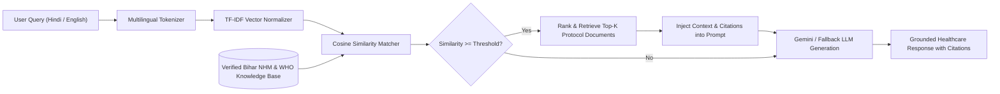

# 📚 Retrieval-Augmented Generation (RAG) Architecture

## Overview

Swasthya Sathi AI incorporates a specialized **Retrieval-Augmented Generation (RAG)** pipeline designed to provide verified, hallucination-resistant clinical and operational context for Primary Health Centre (PHC) staff across Bihar.

Instead of answering purely from ungrounded parametric model weights, the system queries an authoritative medical knowledge repository and injects verified protocols directly into the prompt context before LLM generation.

---

## Architecture Flow



---

## Curated Knowledge Repository

The knowledge base (`backend/rag.py`) includes primary healthcare SOPs curated from **Bihar National Health Mission (NHM)**, **WHO IMNCI**, and **MoHFW**:

| Document ID | Title | Key Domains Covered |
|-------------|-------|---------------------|
| `PHC-MAT-001` | Antenatal Care (ANC) & Maternal Health | 4 ANC Visits, TT doses, IFA & Calcium, High-Risk Pregnancy triggers |
| `PHC-IMM-002` | Universal Immunization Programme (UIP) | Birth to 24 months vaccine schedule, Cold Chain (+2°C to +8°C) |
| `PHC-DIA-003` | Childhood Diarrhea & Dehydration | ORS preparation, Zinc supplementation (14 days), IMNCI danger signs |
| `PHC-KALA-004` | Visceral Leishmaniasis (Kala-Azar) | rK-39 RDT testing, Liposomal Amphotericin B, fever > 15 days |
| `PHC-OPS-005` | ASHA & ANM Operations & Attendance | Field responsibilities, VHSND, 75% attendance threshold follow-ups |

---

## API Endpoints

### Query Endpoint: `POST /api/rag/query`

**Request:**
```json
{
  "query": "Bacche ko dast aur ulti hai ORS kaise dein?",
  "top_k": 2
}
```

**Response:**
```json
{
  "query": "Bacche ko dast aur ulti hai ORS kaise dein?",
  "documents": [
    {
      "doc_id": "PHC-DIA-003",
      "title": "Childhood Diarrhea & Dehydration Management Protocol",
      "category": "Child Health",
      "content": "Standard protocol for acute watery diarrhea in children under 5: 1. Oral Rehydration Salts (ORS)...",
      "source": "WHO / UNICEF Integrated Management of Neonatal and Childhood Illness (IMNCI)",
      "keywords": ["diarrhea", "dast", "ors", "zinc", "dehydration"]
    }
  ],
  "similarity_scores": [0.6842],
  "augmented_context": "[Source: Childhood Diarrhea & Dehydration Management Protocol...]",
  "sources": [
    "Childhood Diarrhea & Dehydration Management Protocol (WHO / UNICEF Integrated Management of Neonatal and Childhood Illness (IMNCI))"
  ]
}
```

---

## Running RAG Verification Tests

```bash
cd backend
python -m pytest tests/test_rag.py -v
```
